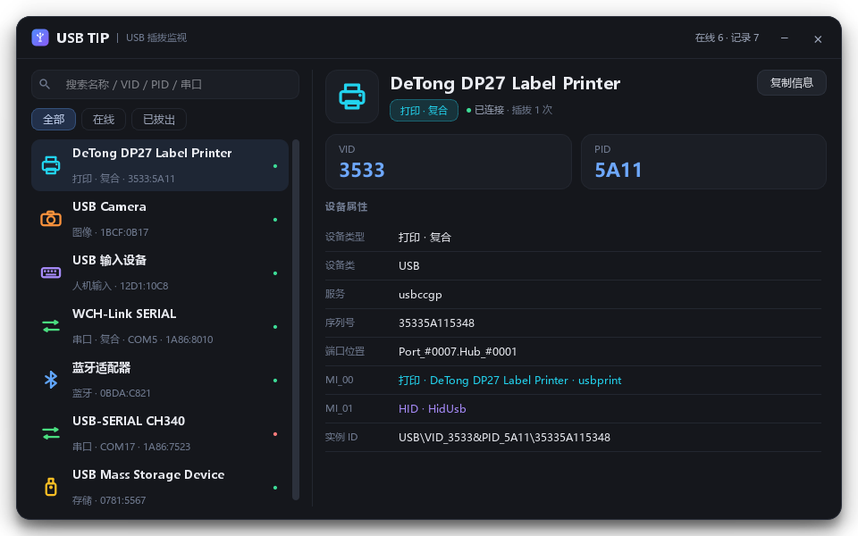

# USB TIP —— USB 插拔监视器

插上/拔掉任何 USB 设备，屏幕右下角立刻弹一张卡片告诉你是谁：**名字、VID、PID、类型**。
点一下卡片就展开完整明细面板。

纯 Python + PySide6 实现，**不需要管理员权限、不装驱动、不开后台服务**。




## 为什么需要它

搞嵌入式的时候插一堆小板子（CH340 / CP2102 / ST-Link / WCH-Link / DAP-Link / U 盘），
系统只会「叮」一声，根本不知道刚插上的是哪一颗。这个工具把这声「叮」补全。

## 功能

- **插拔即时提示**：右下角滑入卡片，6.5 秒自动消失，鼠标停留则暂停倒计时；点卡片直接跳到该设备明细
- **一眼看清身份**：设备名 + 类型徽章 + `VID_xxxx PID_xxxx`，串口直接给出 `COMx`
- **复合设备看得全**：WCH-LinkE 这类一块板子多个功能的，卡片底部列出 `[WCH 调试] [串口 COM5]`，
  面板里逐个列出 `MI_00` / `MI_01` 接口
- **点击看明细**：类型、设备类、制造商、服务、序列号、端口位置、实例 ID、插拔记录
- **历史记录**：拔掉的设备不丢，留在列表里带插拔次数
- **搜索 / 过滤**：按名称、VID、PID、COM 号搜索；全部 / 在线 / 已拔出
- **托盘常驻**：左键打开面板，右键菜单可暂停提示、开机自启、退出
- **一键复制**：「复制信息」按钮复制完整文本，方便贴给同事或搜索引擎

## 快速开始

```bash
pip install PySide6
python py/usbtip.py
```

Windows 上也可以直接双击 `run.bat`（用 `pythonw` 启动，不留黑框）。

| 参数 | 效果 |
|---|---|
| 无 | 启动并打开面板 |
| `--hidden` | 静默启动，只留托盘（开机自启用这个） |
| `--demo` | 弹一张假卡片，用来调样式 |

> Win11 默认会把新注册的托盘图标收进 `^` 溢出区，拖出来一次即可，之后系统会记住。

## 权限说明

全程只调用 `cfgmgr32.dll` 的只读枚举接口（`CM_Get_Device_ID_ListW`、
`CM_Get_DevNode_Registry_PropertyW` 等），读取设备节点属性，
**不打开设备、不读写 USB 端点、不加载内核驱动**。

没有 `requestedExecutionLevel` 提升声明，双击运行不会弹 UAC。
开机自启写在 `HKCU\Software\Microsoft\Windows\CurrentVersion\Run`（当前用户，非全局）。

## 识别原理

后台线程约每 360ms 用 `CM_Get_Device_ID_ListW` 拉一次 USB 枚举器下的**在位**设备实例 ID，
和上一次比对：

- 出现新条目 → 弹「已插入」
- 条目消失 → 弹「已拔出」
- 已经记录过、之前是拔出状态的设备再次出现 → 也算插入，再弹一次

细节：

- **归并**：同一 `VID/PID` 的父节点和各接口节点（`&MI_00`、`&MI_01`…）归并为一台设备
- **选主接口**：按设备类 + 服务名打分挑信息量最大的接口。
  服务名必须参与打分——例如 `usbprint` 驱动的接口挂在通用的 `class=USB` 下，
  只看 class 会让同设备的 HID 接口抢走主位置，把打印机显示成「USB 输入设备」
- **复合设备**：归并后若存在两种以上不同功能的接口，标记为复合，卡片加高一行显示各功能
- **缓存**：设备属性只在首次出现时读一次，之后每轮只比对 ID 列表，常驻几乎不占 CPU
- **过滤**：根集线器（`USB\ROOT_HUB*`）和没有 VID/PID 的节点不算「插上去的 USB 设备」，不进列表

## 类型识别

按设备类（Class）+ 服务名（Service）+ 名称关键字推断：

| 类型 | 判断依据（节选） |
|---|---|
| 串口 | `class=Ports`，并从友好名里提取 `COMx` |
| 存储 | `service=USBSTOR` |
| 打印 | `class=Printer` / `service=usbprint` |
| 图像 | `class=Image/Camera` / `service=usbvideo` |
| 人机输入 | `class=HIDClass`，或名称含键盘/鼠标 |
| 网络 | `class=Net` |
| 音频 | `class=Media/AudioEndpoint` |
| 蓝牙 | `service=BTHUSB` / `class=Bluetooth` |
| 集线器 | `service=USBHUB*` |
| 其他 | 兜底归为「USB 设备」 |

每种类型有自己的配色和矢量图标（全部用 `QPainter` 画的，无图片资源）。

## 项目结构

```
py/
├─ usbtip.py     入口：托盘 + 监测线程 + 插拔事件分发
├─ usbm.py       ctypes 直调 cfgmgr32 枚举设备、归并接口、类型推断
├─ panelwin.py   主面板（Qt 控件 + QSS）
├─ toastwin.py   右下角通知窗口（透明置顶、淡入淡出、叠放）
├─ toastcard.py  通知卡片绘制（QPainter）
├─ theme.py      配色 / 字体 / 全局样式表
└─ icons.py      设备类型矢量图标 + 程序图标
run.bat          Windows 启动器（pythonw，无控制台）
rust-legacy/     最早的 Rust + egui 版本，已废弃，留作参考
```

## 已知限制

- 只监听 USB 枚举器。纯 ACPI/PCI 设备不在范围内。
- 同型号同 VID/PID、又没有序列号的两台设备插在不同口时会被合并成一条 ——
  Windows 没有提供「接口节点 ↔ 端口路径」的对应关系，无法可靠拆分。
- 多显示器且不同 DPI 时，通知固定在主屏右下角。
- 设备名由系统提供，个别驱动给的是「USB 输入设备」这类笼统描述，此时以 VID/PID 为准。
